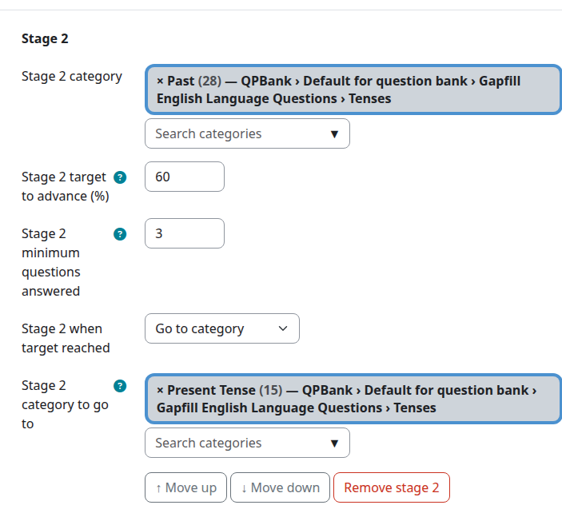
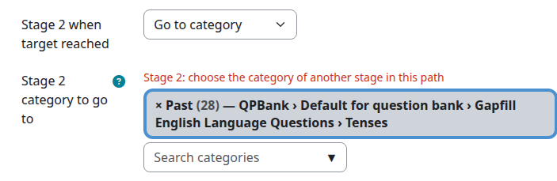
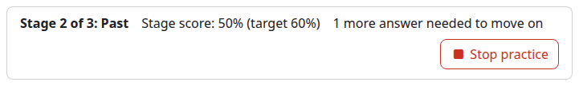
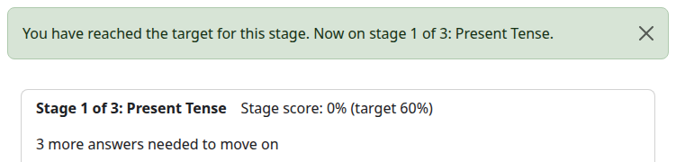

# Question Practice: User Guide

Question Practice (`mod_qpractice`) is a Moodle activity that lets students practise
questions from the course question banks, one question at a time, for as long as they
like. Unlike a quiz, there is no fixed set of questions, no time limit and no grade
in the gradebook. Students choose when to start, when to stop, and can come back for
more sessions whenever they want.

This guide covers:

- [For teachers: setting up the activity](#for-teachers-setting-up-the-activity)
- [For students: practising questions](#for-students-practising-questions)
- [Reports](#reports)
- [For administrators: site settings](#for-administrators-site-settings)

---

## For teachers: setting up the activity

### Before you start

Question Practice takes its questions from **question banks** (the Moodle 5.x
*Question bank* activity). You need at least one question bank with questions in it,
either:

- in this course, or
- a shared bank higher up the course category tree (or at site level) that you have
  permission to use.

If no banks are found, the settings form shows the warning
*"No question banks/categories found"*.

### Adding the activity

1. Turn editing on and choose **Add an activity or resource → Question Practice**.
2. Give it a **name** (shown on the course page) and, optionally, a description.
3. Choose how students will move through the questions: **free choice** or a
   **category path** (see below).
4. Choose the **behaviours** students may use.
5. Save.

### Option 1: Free choice of categories (default)

Leave **Enable category path** unticked.

- Tick the question categories students may practise from. The number in brackets
  after each category is how many questions it holds. Hover over a category name to
  see its description, if it has one.
- If more than one question bank is available, use the **Question bank** drop-down to
  switch between them. Categories you ticked in other banks stay ticked.
- **Select all / none** ticks or clears every category.
- You must select at least one category.

When a student starts a session, they pick one or more of these categories to draw
questions from.

#### Practising previously incorrect questions

Tick **Allow practising previously incorrect questions** to let students start a
session containing only questions they got wrong last time they answered them. A
question that was wrong once but answered correctly later no longer counts as
incorrect. This option is not available when a category path is enabled.

### Option 2: Category path

Tick **Enable category path** to make students work through categories in a fixed
order, a bit like levels. Each step in the path is a **stage**. Students cannot choose
their category: they always get questions from the stage they have reached.

For each stage set:

| Setting | Meaning |
|---|---|
| **Category** | The category the stage draws questions from. Type to search; each entry shows its question count and where it sits in the bank. A category can only be used in one stage, and it must contain questions of its own (a parent category with only sub-categories cannot be chosen). |
| **Target to advance (%)** | The score needed to move on, from 1 to 100. |
| **Minimum questions answered** | How many questions the student must answer on this stage before the target can move them on. 0 means no minimum. |
| **When target reached** | **Move to next stage**, **Go to category**, or **Stay on this stage** (the stage never advances, so no target is needed). |
| **Category to go to** | Shown when **Go to category** is chosen. The category of another stage in the path, earlier or later. See [Sending students to another stage](#sending-students-to-another-stage). |

Use **Add stage** to add more stages, **↑ Move up** / **↓ Move down** to reorder them,
and **Remove stage** to delete one.

The **final stage** has no target or minimum, as there is nowhere further to go.
Students keep practising that category for as long as they like.

#### Sending students to another stage

By default, a student who reaches a stage's target moves to the next stage in the
list. To send them somewhere else, set **When target reached** to **Go to category**
and choose a **Category to go to**. On reaching the target, the student moves to the
stage that uses that category.

The category must belong to another stage in this path. To send students to a
category that is not yet in the path, add a stage for it first. The form rejects a
category that is not used by any stage, or the stage's own category.

Every student who reaches the target goes to the same stage. There is no way to send
students to different stages depending on their score.

Because each stage leads to only one place, a jump changes the shape of the whole
path:

- **Going back makes a loop.** If stage 3 goes to stage 1, students work through
  stages 1, 2 and 3, then start again at stage 1, and so on for as long as they
  practise. They never reach the stages after stage 3. Use this for rotating
  practice, for example cycling through three topics, each until its target is met.
- **Skipping ahead leaves stages out.** If stage 1 goes to stage 3, no student ever
  works on stage 2 unless another stage sends them there. This is a way to take a
  stage out of use for a while without deleting its settings.

Things to know:

- The student's stage score starts again from zero on the stage they move to, and
  that stage's own target, minimum and **When target reached** setting then apply.
- A student who goes round a loop starts each stage again from zero every time they
  return to it.
- The link is to a category, not to a position, so reordering stages with
  **↑ Move up** / **↓ Move down** does not change where a stage sends students.
- If you later remove the stage a link points to, the form asks you to choose
  another category before it saves.

#### How the stage score works

- The score is the marks the student has earned as a percentage of the marks
  available, across every question they have answered **on the current stage**.
- It is checked after every answer.
- It carries across sessions: if a student stops part-way through a stage, their
  progress is still there next time.
- When they move to a new stage, the score starts again from zero.

**Tip:** always set a minimum number of questions. Without one, a target can be met
too early. For example, with a 50% target and no minimum, a correct first answer
(100%) moves the student on straight away.

### Behaviours

Tick the question behaviours students may choose from when starting a session (for
example *Adaptive mode*, *Interactive with multiple tries*, *Immediate feedback*).
You must tick at least one. Only behaviours that show students whether their answer
was right are offered, since practice without feedback is not much use. The ticked
defaults come from the site settings.

### Backup, restore and duplication

The activity's settings, including its categories and category path, are kept when
the activity is backed up and restored, or duplicated.

---

## For students: practising questions

### The activity page

When you open the activity you see up to three options:

- **Continue last session**: shown if you left a session unfinished. Picks up where
  you stopped.
- **Create a new session**: start practising.
- **Show Past Sessions**: shown once you have done at least one session. Lists your
  previous sessions and scores.

### Starting a session

On the **Setup Practice** page:

1. **Category**:
   - If your teacher lets you choose, tick one or more categories.
   - If there is only one category, or your teacher has set up a category path, the
     category is chosen for you and just shown on screen.
2. **Behaviour**: choose how questions behave, for example whether you get one try
   with immediate feedback or several tries with hints.
3. **Only give me questions I previously got wrong** (if offered): tick this to
   revisit only the questions you got wrong last time you answered them.
4. Click **Start Practice**.

Starting a new session ends any session you left unfinished.

### Answering questions

Questions appear one at a time, picked at random from your chosen categories. You
will not see the same question twice in one session.

A box at the top of the page shows:

- what you are practising: the category of the current question or, on a category
  path, your stage (for example *Stage 2 of 4: Tenses*), your score on that stage,
  the target you need, and how many more answers you need before you can move on;
- once you have answered a question, how many you have **answered**, how many were
  **correct**, and your **score** so far this session.

- Answer the question and use its **Check** button (depending on the behaviour) to
  see feedback.
- **View next question**, under the question, records your result and gives you
  another question.
- **Stop practice**, at the top right of the box, takes you to the summary page. An
  answer you have not yet checked or moved on from is not saved.

If there are no questions left, you see *"Sorry, no more questions to display. Try a
different category"* and go to the summary.

### Category path

If your teacher has set up a category path, you work through the categories in
order. Your score on the current stage needs to reach the target (and you may need
to answer a minimum number of questions) before you move on. The box at the top of
the page shows your stage score, the target and any answers still needed:

When you reach the target you see a message naming your new stage. Here, stage 2 is
set to send students back to stage 1:

Your next question then comes from your new stage. This is usually the next stage,
but your teacher can set a stage to send you elsewhere, so you may skip stages or go
back to an earlier one. Progress is saved between sessions, so you can stop at any
time.

### The summary page

When you stop, the summary shows:

- your total questions attempted and marks obtained for the session,
- a **Score by category** table with questions attempted, number right, marks and
  percentage for each category,
- **View categories covered**, listing the categories in the session (and, in a
  category path, which stage each one is).

Then choose:

- **Resume Practice** to go back to the question you were on, or
- **Submit and Finish Practice** to end the session and return to the activity page.

---

## Reports

**Show Past Sessions** opens a report of practice sessions in this activity.

The report lists the practice date, marks obtained, and how many questions were
viewed and answered correctly, with a **View details** link to the categories covered
in each session. It uses Moodle's standard report builder, so you can sort it, filter
it by marks or date, and download it.

### Who can do what

| Capability | What it allows | Default roles |
|---|---|---|
| `mod/qpractice:addinstance` | Add the activity to a course | Editing teacher, manager |
| `mod/qpractice:view` | Open the activity | Everyone, including guests |
| `mod/qpractice:attempt` | Practise questions | Student |
| `mod/qpractice:viewmyreport` | See their own past sessions | Student, teacher, editing teacher, manager |
| `mod/qpractice:viewallreports` | See everyone's past sessions | Teacher, editing teacher, manager |

---

## For administrators: site settings

Go to **Site administration → Plugins → Activity modules → Question Practice**.

- **Question behaviours**: choose which behaviours are ticked by default when a
  teacher creates a new Question Practice. *Interactive with multiple tries* is on by
  default. Teachers can still change the selection for each activity.

---

## Privacy

Question Practice stores each student's practice sessions (date, categories, marks,
questions answered) and, for category paths, which stage they have reached and their
running score on it. This data is included in Moodle's privacy export and deletion
tools.

## More information

- Moodle docs: <https://docs.moodle.org/en/Question_practice_module>
- Source code and issues: <https://github.com/marcusgreen/moodle-mod_qpractice>
